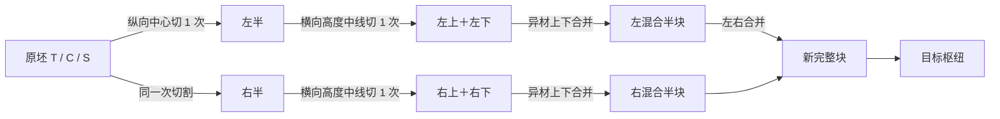

# 四瓣挑战规则与验收记录（2026-09-23）

> 历史记录：2026-10-14 合成系统已重构，当前规则以 [SYNTHESIS.md](SYNTHESIS.md) 为准。固定6种半配方/36种最终配方、异材限定、固定两级合成、原坯禁止横切及非目标瓣自动回收均已取消。本文保留旧版本定位与测试记录，不能作为当前合成合法性的依据。

本文件记录已实现的 `petal-v3` 规则。设计依据包括 [原可行性方案](shapez-feasibility-plan.md)；出口行为遵循已批准的 [切割机修复方案](docs/superpowers/plans/2026-09-24-cutter-output-fix.md)。C1、C2、C5、C6 使用新规则；教程、自由、每日、C3、C4 保留经典四象限加工逻辑，但正方形产物统一显示为梯形。旧 `trapezoid-v2` 仅保留作蓝图迁移和回归测试，不进入发行版。

## 机制流程与固定配方



完整切割链是 3 次加工：1 次 `raw→2 vertical-half`、2 次 `vertical-half→2 quarter`。每次进入切割机只执行一级；自动档按输入阶段选择纵切或横切。半块必须从出口离开，再由外部传送带送回同一台或另一台切割机，才会发生第二级切割。完整合并链也是 3 次加工：2 次 `quarter+quarter→mixed-half`、1 次 `mixed-half+mixed-half→finished`。切割机和混合机各只有一种可放置类型。锁定档可指定纵切／横切、半块／最终合并。输出堵塞时产物停在独立出口托盘，加工位与入口队列保持分离。

纯配方表固定在 `js/petal-v3.js`。切割表：`raw(T/C/S)` 仅可纵切成左右半，`vertical-half(T/C/S,L/R)` 仅可横切成上下四瓣；`quarter`、`mixed-half`、`finished` 不可再切。混合表：同侧的上瓣 `X` 与下瓣 `Y` 必须异材，合法有序半配方为 `H_TC/H_CT/H_TS/H_ST/H_CS/H_SC`；左、右半块各取其中任一配方，共有 36 种合法 `F_<左>_<右>` 成品。不同规则集、重复来源单元、错侧、错上下、方向不一致及同材半块均被拒绝。`unitIds` 始终守恒，不把结构上的四瓣误当等质量四份。

自动切割机将本次切割的两个产物直接放入前、侧两个物理出口托盘。无下游时产物保持原阶段、原身份，接通传送带后分别排出；两侧未排空前不能开始下一次加工。自动混合机按当前目标优先配对，把混合半块留在内部待最终合并。目标不需要的四瓣在入口明确标记为「非目标瓣」废料，记录于 `discardedItems` 和 `discardReasons`；这是自动调度及回收策略，**不修改**固定合成表。玩家也可选择锁定模式与垃圾桶自行布线。

所有可放置机器在载物、排队、加工、暂停及已通关状态下均可拆除。拆除时机器内的物品进入废弃记录，机器预算退还；撤销拆除只恢复空机器，不复原已废弃物料。资源节点和目标枢纽仍属于地图格位，不是可拆除机器。

## 视觉与碰撞规范

可审阅设计稿：[visual-spec-v3.svg](visual-spec-v3.svg)。

`T` 是上底宽为下底 0.6 倍的等腰梯形；纵切通过对称轴，横切通过包围盒高度中线 `y=0.5H`。上、下四瓣可以不等面积，`1/4` 指槽位而非原坯面积的 25%。四瓣保留原轮廓的对应斜边、弧线或星尖，分别显示为 `TL/TR/BL/BR`。T 用蓝青色和斜线，C 用橙黄色和点纹，S 用紫色和放射线；资源节点标示 T/C/S。颜色以外仍有轮廓／纹理区分。V3 切割机的两个出口托盘位于正面和右侧，半块停在托盘时与中央刀口分离，悬浮信息显示各出口的产物阶段与等待原因。四向传送带不显示方向箭头；带面斜纹按实际流向滚动，包括尚未供料的布线阶段。机器和物品碰撞继续以网格格位及入口／出口判定，几何轮廓不参与碰撞。

## 关卡参数与内部 QA 布局

坐标以左上 `(0,0)` 为原点，网格为 `24×16`。每关公开画面仅有三个资源点和枢纽，**以下测试线路不写入关卡配置、不显示在挑战界面**。

| 关卡 | 必需资源（均提供 T/C/S 三源） | 资源点 T / C / S | 初始原坯 | 枢纽 | 目标及交付数 | 机器上限 | 内部参考解 |
|---|---|---|---|---|---|---|
| C1 低 | T、C | `(2,3)/(2,8)/(2,13)` | 3（各 1） | `(21,8)` | `F_TC_TC ×3` | 全部不限 | 3 切割、1 混合、2 采集、49 带；694 tick；3★ |
| C2 高 | T、C、S | `(2,3)/(2,12)/(20,2)` | 6（各 2） | `(20,13)` | `F_TC_TS ×6` | 全部不限 | 3 切割、1 混合、3 采集、62 带；890 tick；2★ |
| C5 低 | C、S | `(2,3)/(2,8)/(2,13)` | 3（各 1） | `(21,8)` | `F_CS_CS ×4` | 采集≤3、传送带≤80；其他不限 | 3 切割、1 混合、2 采集、52 带；780 tick；3★ |
| C6 高 | T、C、S | `(2,2)/(2,13)/(20,2)` | 6（各 2） | `(20,13)` | `F_TC_SC ×8` | 采集≤3、传送带≤80；其他不限 | 3 切割、1 混合、3 采集、64 带；1052 tick；2★ |

四张内部 QA 路线共用下图的中央加工区。坐标取自 `test-v3-runtime.js`；左侧资源沿 `x=4` 汇入，右上资源（C2/C6）沿 `y=2` 向左、再沿 `x=8` 向下。第一次切割的两半块分别沿前、侧出口送往两台二级切割机；四路四分之一块汇入 `y=12` 传送线，由 `(17,12)` 混合机合成成品，再输送到枢纽。此图是测试布线说明，挑战不提供参考布线。

```text
左侧资源 → 采集 → x=4 汇流 → (8,5) 首次切割 → 前出口 → (11,5) 二次切割 ─┐
                                            └→ 侧出口 → (9,8) 二次切割 ─┤
四路四分之一块 → y=12 汇流 → (17,12) 混合 → 枢纽前一列 → 枢纽
右上资源（C2/C6）→ y=2 向左 → x=8 向下 ↗
```

每个资源节点可持续供料，没有总量上限。进入关卡时的初始缓存为低难各 1、高难各 2；缓存用尽后，采集器按节点序号生成新的完整原坯，且共享同一资源点的采集器不会复用物品 ID。各源每 3 个传送节拍产出 1 个原坯，给共享输送线留出汇流空档；出口堵塞时只保留当前物品，不继续生成。四关自动供料；重置供料会恢复初始缓存、生成序号、加工队列和交付数而保留布线。C5/C6 的预算是放置上限，蓝图整组预检同样扣算。

## UI、蓝图与 C4

所有模式共用顶栏、工具栏和右侧蓝图抽屉。四关不显示参考路径按钮、挑战文字提示、预放机器或幽灵布线；顶栏仅给目标图、配方 ID 和交付进度。除 C4 外，各关均不显示供料按钮。抽屉展示供料／废料数、切割与混合模式、重置供料、蓝图导入导出。蓝图用 `.slbp.json` 版本 3 格式，严格校验格位、方向、机器及模式，本地库仍存在 `localStorage`。旧 `trapezoid-v2` 蓝图保留原件并生成只读迁移预览，不未经核对直接粘贴。

C4 进入时为准备态，倒计时保持 60 秒；只有点击「启动供料」后模拟 tick 和倒计时才推进，暂停冻结，400 tick 到时结算。窄屏顶部独立显示倒计时。

## 已执行验证与待测风险

自动验证覆盖四向无下游出口的 T/C/S 原坯、单侧补接传送带、加工中移除下游、暂停、半块外部回流、四分之一块拒收、出口托盘绘制及四关真实产线。持续供料测试覆盖四关的全部三种资源、10,000 tick 长跑、同源双采集器、堵塞疏通与重置，并核对每个生成原坯的 `unitIds` 唯一且无丢失。四关参考路线通过网格、机器端口及枢纽，逐步核对全部 `unitIds` 守恒，并满足 C5/C6 的机器预算。当前参考线使 C1/C5 达到 3★，C2/C6 达到 2★；尚未证明高难度 3★ 的最短布线，暂不调整星级线。

尚未进行六名真实玩家的难度试玩，也未收集完成率与误读率；三星阈值和源点间距后续应在试玩后调整。自动混合模式的非目标瓣回收应在试玩中重点观察玩家是否理解。旧 `trapezoid-v2` 蓝图的迁移预览不能直接粘贴，需玩家核对其端口、资源与几何语义。依赖旧版切割机内部双切的 V3 蓝图仍可加载，但必须补接外部第二级切割线路；系统不自动改写玩家布局。
