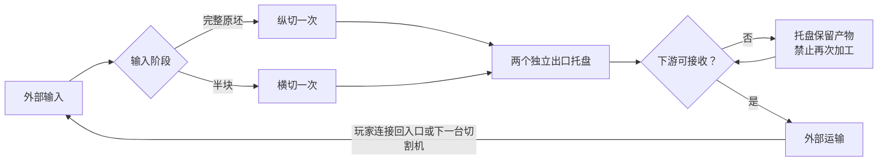

# 切割机产物排出修复方案（已实施）

> 用户已批准“单次入机切一级＋出口托盘暂存”规则。执行与验证结果见 [修复交付记录](../../2026-09-24-cutter-output-fix-report.md)。

**Goal:** 每次进入切割机只完成一次切割；产物进入独立出口托盘，任何输出阻塞都不能触发内部再次切割。

**Architecture:** 沿用入口队列、单加工位及 outA/outB 输出缓冲。移除自动切割机内部半块回流，自动模式只根据当前输入阶段选择一次切割。出口托盘属于机器输出缓冲，逻辑上与加工区隔离，画面上位于两个出口端。

**Tech Stack:** 原生 JavaScript、Canvas、Node.js VM 回归测试、单 HTML 构建。

## 1. 已确认根因与复现证据

调查文件：`js/challenge-v3.js`、`js/petal-v3.js`、`js/render.js`、`test-v3-runtime.js`。

- `PetalV3.cut()` 本身每次只切一级，规则函数没有把原坯直接切成四瓣。
- `V3Runtime.machines()` 对自动档原坯建立 `autoStage: 'vertical'` 特殊任务。
- 纵切结束后，两半块被写入 `autoQueue`，而不是正常的 `outA/outB`。
- 下一次调度直接从 `autoQueue` 取半块横切。该路径不要求半块离机、经过传送带或重新入机；即使已接传送带，也会发生内部双切。
- `movement()` 在没有下游时保留输出物料，这一本身是正确的防丢料行为；问题是自动档在首次切割后没有进入这条输出路径。
- 现有出口阻塞测试使用纵切锁定档，四关通关测试反而依赖自动档内部双切，因此遗漏了该异常。

本轮以真实模拟逻辑、完整梯形输入、两个出口均空置复现（未改源码）：

| 时刻 | 自动档当前行为 | 纵切锁定档对照 |
|---|---|---|
| tick 2 | 纵切任务开始 | 纵切任务开始 |
| tick 4 | 两个半块进入内部横切队列，出口为空 | 两个半块进入出口 |
| tick 5 | 其中一个半块开始内部横切 | 两个半块保持在出口 |
| tick 7～16 | 两个四分之一块堵在出口，另一个半块留在内部 | 两个半块保持在出口 |

准确边界：当前版本在“两个出口完全无下游”时不会立即把所有半块都切完，但已发生不应有的二次切割；出口疏通后另一半块也能继续被内部横切。

## 2. 建议审批的行为规则

1. 自动档收到完整原坯：纵向中心切割一次，输出两个半块。
2. 自动档收到外部输入的半块：横向中心切割一次，输出两个四分之一块。
3. 四分之一块不允许再次进入切割加工。
4. 首次切割完成后立即清空加工位，产物转入出口托盘，不依赖下游是否存在。
5. 无传送带或其他合法接收设备时：产物保留在托盘，显示“出口未连接，产物待取”。不丢弃、不凭空生成传送带、不放进入口队列。
6. 两个出口独立排出；一侧接通可先排出该侧产物，另一侧保留。两侧未排空前不启动下一次加工，入口仍按现有容量缓存。
7. 补接正确方向的传送带后自动恢复运输，不要求重开或重置供料。
8. 切换机器模式不能把出口产物变成新输入。只有外部运输使半块再次进入合法入口，才能开始第二级切割。

这里的“离开切割区域”指进入出口托盘，不是掉落到空白地块。落地物品、拾取及地面堆叠属于额外机制，不纳入本方案。



## 3. 实施步骤

### 任务一：修复自动档加工与输出边界

文件：`js/challenge-v3.js`、`test-v3-runtime.js`。

- [x] 补充自动档断开输出测试，使用 `PetalV3.raw(kind, id)` 经入口传送带进入切割机；推进至少 100 tick 后断言两个输出均为 `vertical-half`、`proc` 为空、内部待切队列为空、四个 unit ID 不重不漏。对 T/C/S 及四个朝向参数化运行，先确认当前实现失败。
- [x] 删除 `autoStage === 'vertical'` 完成分支和读取 `autoQueue` 进行横切的调度分支。
- [x] 自动档与锁定档共用已计算的 `PetalV3.cut(input, mode)` 结果创建任务：

```js
c.proc = {
  shape: result[0],
  shapeB: result[1] || null,
  t: PROC_TICKS
};
```

- [x] 所有切割结果经现有任务完成分支转入 `outA/outB`。保留混合机 `autoStage === 'half'` 行为；此次不改变混合规则。
- [x] 统一出口等待状态，避免 `movement()` 的“未连接”原因被 `machines()` 的通用等待文字覆盖。按前出口、侧出口分别判断未连接、方向错误、占用，保留明确的等待说明。
- [x] 检查 `autoQueue` 在占用检查、重置和物料统计中的引用，只清理已确定属于废弃内部切割流程的引用；不删除混合机使用的 `autoHalves`。
- [x] 运行 `node test-v3-runtime.js`。新增断开出口用例必须通过；旧通关路线预期需要在任务三重写，不能删除测试或放宽目标来绕过失败。

### 任务二：让加工区与出口托盘清晰分离

文件：`js/render.js`、`js/input.js`、`test-render-v3.js`。

- [x] 在 V3 切割机的前、侧出口端绘制独立托盘区域；仅调整该机器的输出物品定位，避免两个产物仍重叠在中央刀口。
- [x] 托盘位置沿用 `DIRV[c.dir]` 与 `DIRV[(c.dir + 1) % 4]` 旋转，产物按缩放比例绘制并限制在所属机器可视范围，避免遮住相邻机器。
- [x] 悬浮信息明确显示两个出口的产物阶段及等待原因；无加工任务时不显示加工进度。
- [x] 自动档说明改为“按输入阶段选择切割方向；每次进机只切一次”。不新增方向箭头，不改变传送带动画。
- [x] 扩展 `test-render-v3.js`，验证四个朝向的两个出口位置相互分离、不同于加工中心；浏览器检查正常和窄屏缩放下不会被误认为仍在加工。

### 任务三：验证完整生产链及既有数据兼容性

文件：`test-v3-runtime.js`、`test-v3-integration.js`、`README.md`、`V3-IMPLEMENTATION.md`，必要时同步实际存在的配方说明文案。

- [x] 把依赖单台机器内部双切的四关测试路线改为真实的外部两级切割路线：原坯经过第一次切割，两个半块分别运输到第二级切割机，四瓣再送混合机。使用的仍是同一类多功能切割机。
- [x] 同时验证单台切割机外部回流路线：半块离开出口后经传送带回到合法入口才横切；四分之一块不会再次进入切割机。
- [x] 维持 C1/C2/C5/C6 的目标配方与数量，验证 C5/C6 的 3 采集器、80 传送带上限。若新路线超过既有星级线，记录实测数据与调整建议，另行提交审批，不直接放宽配置。
- [x] 蓝图格式和导入导出字段不变，验证 `auto/vertical/horizontal` 模式保存、加载及旋转正常。明确说明：依赖旧内部双切的蓝图仍可加载，但需要补上外部第二级切割线路；不偷偷重写玩家布线。
- [x] 更新 README 与实现记录，删除“自动档一次入机完成两级切割”的说明。

### 任务四：回归与交付

- [x] 运行全部 `test*.js`，任何失败均需分析并解决；不以删测试替代修复。
- [x] 浏览器检查源码版和打包版双托盘、单侧接通及窄屏显示；堵塞疏通、加工中移除下游、暂停恢复、蓝图模式等行为由自动化回归覆盖。
- [x] 运行 `node build.js`，生成 `dist/shape-line.html`；记录构建结果及验收报告。

## 4. 验收矩阵

| 场景 | 必须满足的结果 |
|---|---|
| T/C/S 完整原坯、自动档、无下游 | 两个半块进入托盘；持续运行仍为半块 |
| 两侧都有下游 | 首次输出仍是两个半块，不因已接传送带而内部双切 |
| 仅一侧可接收 | 一侧正常排出，另一侧保留，禁止启动下一任务 |
| 下游满载或方向错误 | 不覆盖、不丢弃、不重复生成、不再次切割 |
| 堵塞后补接或疏通 | 输出原先等待的同一批物品，unit ID 不变 |
| 外部半块进入自动档/横切档 | 一次横切生成两个四分之一块 |
| 四分之一块进入切割机 | 拒收，保留在原运输位置 |
| 模式切换、暂停、调速 | 不导致出口产物重新加工 |
| 四向机器及缩放 | 托盘位置正确，中央加工区与输出明确分离 |
| 四个挑战关及蓝图 | 真实外部两级切割可通关，预算和物料守恒通过 |
| 其他玩法与 C4 | 原有切割合并、按钮及计时测试继续通过 |

## 5. 已批准的规则

核心规则：**自动档每次入机只切一级；无下游时产物停在出口托盘；第二级切割必须经过外部运输后重新入机。**

已交付修复源码、扩展回归测试、可运行单文件游戏及更新后的规则说明。具体结果和未覆盖的人工测试见修复交付记录。
